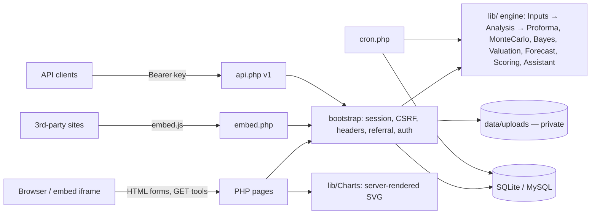
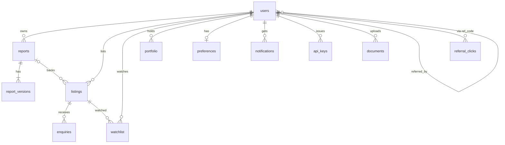

# 03 — Architecture, data model, API, security, deployment, monitoring

## 1. Architecture options considered

| Option | Pros | Cons | Verdict |
|---|---|---|---|
| A. Next.js + NestJS + FastAPI (Python quant) + Postgres/PostGIS + Redis + workers | Best long-term scale, Python science stack (PyMC, LightGBM), SSR/ISR | Needs Node/Python hosting, containers, CI; cannot run on the target shared host | **Target for Phase 4+** |
| B. Next.js on Vercel + serverless functions + managed Postgres | Fast frontend, low ops | Monte Carlo in serverless time limits; vendor lock-in; still not on target host | Viable later for the frontend only |
| C. **Modular PHP 8 monolith + SQLite/MySQL, server-rendered, no build step** | Deploys to the requested path `rundemlabs.com/githubtest2/realestate` on shared hosting; zero build; fast TTFB; one tested engine | Single process; no native ML libraries; scaling via vertical/host upgrade | **Chosen for v3 staging** |

Decision rationale: the user asked for deployment to an existing shared-hosting staging path running
the current PHP app. Option C ships a working, tested product there now. The calculation engine
(`lib/`) is pure functions with no I/O, so it can be ported 1:1 to a Python service in Option A, with
`tests/run.php` fixtures reused as the cross-language regression suite.

## 2. Architecture diagram

## 3. Module boundaries
`lib/Inputs` (schema, validation, provenance) → `lib/Analysis` (orchestration) → models in
`lib/Models` and `lib/Scoring` → `lib/Assistant` (checks, checklist). Presentation: `lib/View`,
`lib/Charts`, `views/`. Platform: `lib/Db`, `lib/App` (Auth, TOTP, Markdown), `bootstrap.php`.

## 4. Database schema & ERD (source of truth: `lib/Db.php`, schema v3)

Other tables: `events` (analytics), `articles`, `audit_log`, `rate_limits`, `password_resets`,
`jobs_log`, `settings` (flags + schema version). Reports store **inputs and full results as JSON per
version** so any historical report renders exactly as computed, with its engine version.
Migration is automatic on first request; both SQLite and MySQL DDL are generated.

## 5. API specification (v1)
Routing `api.php?r=v1/...` (no rewrite needed). JSON responses; errors
`{"error":{"type","message","fields?"}}`.

| Endpoint | Auth | Rate limit | Notes |
|---|---|---|---|
| GET `v1/health` | none | 60/h/IP (setting) | engine & build |
| GET `v1/schema` | none | same | full input schema |
| GET `v1/tools`, `v1/tools/{slug}?…` | none | same | calculators |
| POST `v1/evaluate` | Bearer `ss_…` (Enterprise) | 1000/h/key | full analysis; 400 with field errors |
| GET `v1/reports/{token}` | none | same | shared reports only; private fields stripped |

Keys are shown once, stored as SHA-256, revocable, `last_used_at` tracked. CORS `*` (no cookie auth).

## 6. Security & privacy specification

| Control | Implementation |
|---|---|
| Auth | `password_hash` (bcrypt default), rehash on login, timing-equalised failure path |
| MFA | RFC 6238 TOTP, ±1 step window, rate-limited verification |
| Sessions | HttpOnly, SameSite=Lax, Secure on HTTPS, path-scoped, ID regenerated on login & hourly |
| CSRF | Per-session token on every POST (`csrf_check`), 419 on failure |
| XSS | All output via `e()`; Markdown renderer escapes first, allows only safe links; CSP `script-src 'self'` |
| SQLi | PDO prepared statements only; no string-built WHERE from input |
| Clickjacking | `frame-ancestors 'self'` except `embed.php` |
| Rate limiting | Login 8/15 min (email+IP), register 5/h, evaluate 30/h guest, enquiries 10/h, API, lab |
| Uploads | ≤ 5 MB, finfo MIME allow-list (PDF/JPG/PNG), random names, outside web path (`data/` denied), served via access-checked `download.php` with sandbox CSP |
| Privacy | No raw IPs (keyed HMAC); essential cookies only; reports private by default; address/coords stripped when shared; preferences never shown to listers; consent checkbox for enquiries |
| Data rights | JSON export; full account deletion (cascades reports, docs, listings, enquiries; anonymises events) |
| Audit | `audit_log` for auth, sharing, moderation, settings, uploads, deletions |
| Abuse | Honeypots, duplicate-listing detection, referral spike detection, impossible-value listing flagging |
| Secrets | `config.php` git-ignored; `.htaccess` denies config, lib, data, tests, docs |

Compliance (GDPR, UAE/Saudi PDPL, financial-promotion and real-estate advertising rules) requires a
legal review per market before production — privacy and terms pages are marked as drafts.

## 7. Deployment plan
See `/realestate/README.md`. Summary: upload/pull `realestate/` to `public_html/githubtest2/realestate`,
ensure `data/` is writable, optionally add `config.php`, run `php cron.php create-admin …` (or
`install.php` with `SS_SETUP_KEY`), add an hourly cron for `cron.php`, smoke-test `api.php?r=v1/health`.
Rollback: the app is self-contained in the folder — restore the previous folder; DB migrations are
additive.

## 8. Production monitoring plan
- **Uptime:** external check on `api.php?r=v1/health` (expects `"status":"ok"`).
- **Errors:** PHP error log (display off in staging/production); job failures emailed to `NOTIFY_EMAIL`.
- **Jobs:** `admin.php?tab=jobs` (status, detail); overlapping runs blocked; kill switch `cron_enabled`.
- **Product health:** admin funnel; report `runtime_ms` stored per evaluation (budget < 2 s p75 at 2,000 sims).
- **Model monitoring:** stale-engine report count; when licensed data exists, add valuation error
  tracking against later transactions.
- **Backups:** nightly copy of `data/*.sqlite` (or MySQL dump) via host backup; restore drill before launch.

## 9. Performance budgets
| Item | Budget | Measured (dev container) |
|---|---|---|
| Initial JS | < 10 KB | ~5 KB (`app.js`), no frameworks |
| CSS | < 30 KB | 21 KB uncompressed |
| Images | 0 raster on core pages | SVG only |
| Full evaluation | < 2 s server | 0.05 s at 2,000 sims, 0.19 s at 10,000 sims (PHP 8.3 CLI, dev container) |
| LCP/INP/CLS | 2.5 s / 200 ms / 0.1 | To measure on the real host with CrUX/Lighthouse after deployment |
